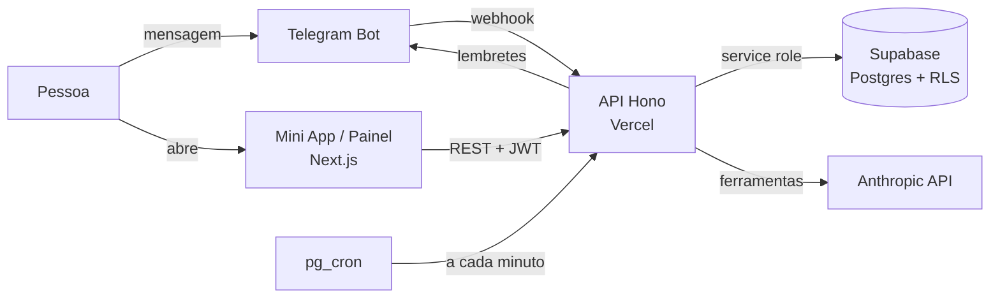

# Nexus

[](https://github.com/phromeiro7/NEXUS/actions/workflows/ci.yml)

Assistente pessoal de tarefas, lembretes e finanças. Você registra por mensagem no Telegram ("gastei 100 em
roupa", "me lembra de ligar para o João amanhã às 10h") e organiza o dia no painel web ou no Mini App do
Telegram. Multiusuário, com dados privados por usuário.

Projeto pessoal de portfólio, em uso real por convite.

## O que ele faz

- **Captura por mensagem:** interpreta frases em português com regras determinísticas (sem custo de IA) e,
  quando a frase é ambígua, passa para um assistente de IA com ferramentas (`claude-haiku-5-5`), com limite de uso por usuário.
- **Lembretes confiáveis:** fila no banco, agendador por `pg_cron`, estado real de cada aviso (agendado,
  enviado, falhou, concluído) e resumo diário.
- **Painel web e Mini App do Telegram:** visões Dia, Semana e Mês, tarefas, adiar tarefa, finanças
  (lançamentos e contas) e configurações.
- **Login sem senha pelo Telegram:** o Mini App entra sozinho com a assinatura do Telegram, e o painel entra por
  QR code confirmado no bot.
- **Acesso por convite:** o cadastro público é fechado; o administrador convida pelo bot ou pela API.

## Arquitetura



Monorepo com pnpm:

| Pasta | Conteúdo |
|---|---|
| `apps/api` | API em Hono. `domain/` e `application/` não dependem de framework; `infra/` fala com Supabase, Telegram e Anthropic. |
| `apps/web` | Painel e Mini App em Next.js 16, React 19 e Tailwind 4. |
| `packages/shared` | Tipos e schemas zod compartilhados entre API e web (`@nexus/shared`). |
| `supabase/` | Migrations (schema, RLS, funções atômicas). |
| `docs/` | Guia de desenvolvimento, identidade visual e planejamento. |

## Decisões técnicas

- **Isolamento por usuário em duas camadas:** filtro explícito na API e RLS no banco. A escrita passa só pela
  API; o cliente web usa o Supabase apenas para autenticar.
- **Idempotência:** cada mensagem do assistente carrega um `clientMessageId`; reenviar reproduz o resultado
  sem criar nada duas vezes, e uma falha depois de gravar devolve resposta parcial verdadeira, nunca uma
  confirmação falsa.
- **Operações atômicas no Postgres:** confirmar ou desfazer uma captura, reivindicar um convite e contar
  chamadas ao modelo são funções SQL, então não há corrida entre requisições simultâneas.
- **Custo da IA sob controle:** regras primeiro, modelo só quando precisa; limite de 30 mensagens por hora por
  usuário, contado em chamadas ao modelo, e nota de custos em `docs/archive/planejamento/notes/`.
- **Segurança do Telegram:** validação da assinatura do `initData`, proteção contra repetição, segredo no
  webhook e no endpoint interno do agendador, corpo limitado a 64 KB antes da autenticação.
- **Domínio puro e testável:** lembretes, janelas do resumo diário, fuso horário e interpretação de frases
  são funções sem I/O, com testes de borda (virada de dia em São Paulo, mudança de horário de verão).

## Testes

```sh
pnpm install
pnpm test        # unitários (API, web e shared), sem Docker
pnpm typecheck
pnpm --filter @nexus/api test:db   # suíte de banco, exige Supabase local (Docker)
```

São mais de 130 arquivos de teste, com CI rodando testes e typecheck a cada PR.

## Rodar localmente

O passo a passo (variáveis, Supabase local, Telegram sem túnel, publicação na Vercel) está no
[guia de desenvolvimento](docs/DESENVOLVIMENTO.md). As variáveis necessárias estão em
[`.env.example`](.env.example).

## Roadmap

- [x] API de tarefas, lembretes e resumo diário
- [x] Bot do Telegram, Mini App e login automático
- [x] Convites, login por QR code e finanças
- [x] Assistente de IA com ferramentas
- [x] Adiar tarefa pelo painel e pelo Mini App
- [ ] Capturas de tela e demonstração no README
- [ ] Avaliação do assistente com o modelo real

## Documentação

- [Guia de desenvolvimento](docs/DESENVOLVIMENTO.md): API, Telegram, lembretes e publicação.
- [Identidade visual e Mini App](docs/nexus/README.md)
- [Produto](PRODUCT.md)
- [Planejamento original](docs/archive/planejamento/): especificações e planos por etapa.

## Licença

[MIT](LICENSE)
